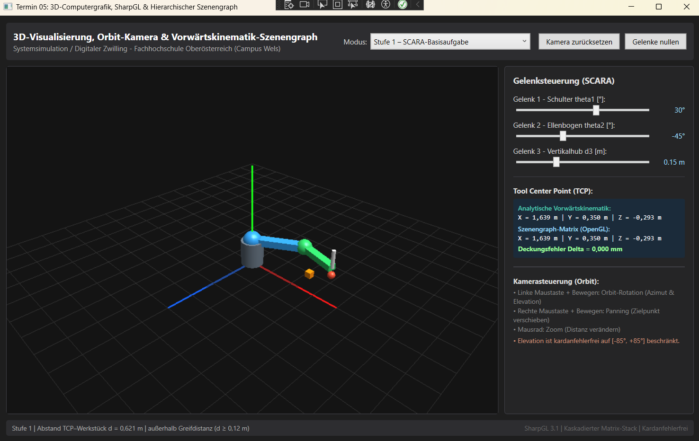
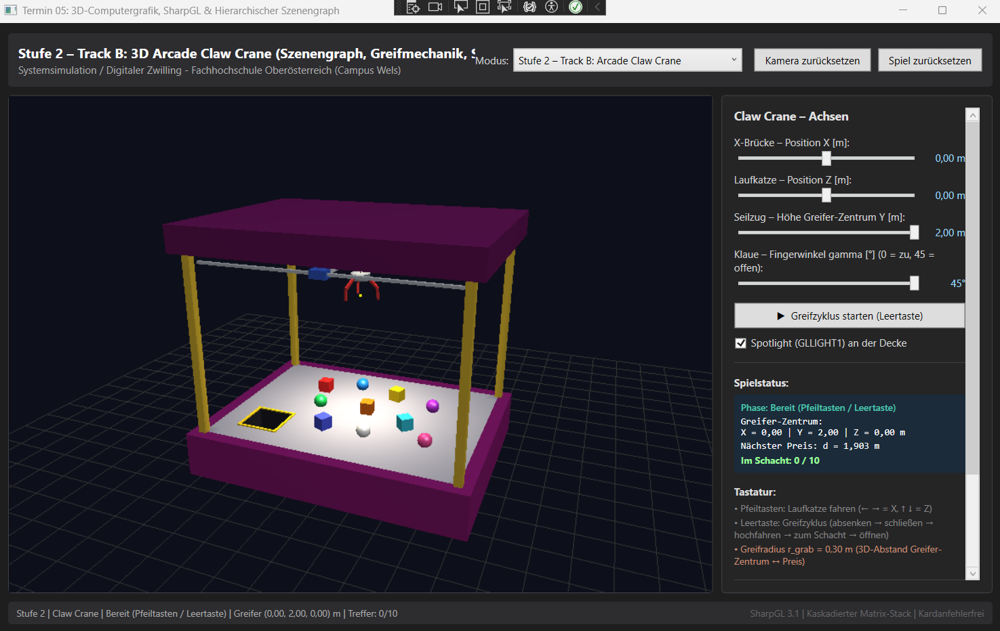

# Termin 05 – 3D-Visualisierung, SharpGL & hierarchischer Szenengraph
Teammitglieder: Brandstätter Nora, Reiter Victoria


C# / .NET 8, WPF + `SharpGL.WPF.OpenGLControl`, Fixed-Function-Pipeline (OpenGL 2.1).
Keine Threads, keine Gleichungslöser – die Kinematik läuft ausschließlich über Transformationsmatrizen.

Über die **ComboBox „Modus“** im Hauptfenster wird zwischen **Stufe 1** (SCARA-Basisaufgabe) und
**Stufe 2 – Track B** (Arcade Claw Crane) umgeschaltet. Jede Stufe behält ihre eigene Kameraeinstellung.





## Steuerung
| Eingabe | Wirkung |
|---|---|
| Linke Maustaste + Ziehen | Orbit (Azimut θ, Elevation φ ∈ [-85°, +85°]) |
| Rechte Maustaste + Ziehen | Panning des Zielpunkts (`OrbitCamera.Pan`) |
| Mausrad | Zoom (Radius r) |
| Stufe 2: Pfeiltasten | Laufkatze: ←/→ = X-Brücke, ↑/↓ = Z (↑ = von der Kamera weg) |
| Stufe 2: Leertaste | automatischer Greifzyklus |

## Stufe 1 – umgesetzte Aufgaben
* **1.1 Szenengraph-Rendering vereint:** Jeder Knoten (`_baseNode`, `_arm1Node`, `_arm2Node`, `_pinoleNode`) besitzt eine
  `RenderCustomGeometry`-Zeichenlogik, `RenderRobot()` ruft nur noch `_rootNode.Render(gl)` auf. Die Skalierung der Arme
  steckt in `Push/Scale/Pop` *innerhalb* der Zeichenlogik, damit Kindknoten nicht verzerrt werden. Deckungsfehler Δ = 0,000 mm.
* **1.2 Kamera-Panning:** `OrbitCamera.Pan(deltaRight, deltaUp)`
  (Δx = −Δright·cos θ, Δz = +Δright·sin θ, Δy = Δup), an die rechte Maustaste gebunden.
* **1.3 Werkstück:** `_workpieceNode` bei (1,10 | 0,06 | −0,40) m, oranger Würfel (0,12 m). In `UpdateTcpCalculations()` wird
  d = ‖p_TCP − p_Werkstück‖ berechnet, in der Statusleiste angezeigt, und das Werkstück wird bei d < 0,12 m grün.

Zusätzlich: `GL_NORMALIZE` ist aktiv (Normalen skalierter Quader haben sonst Länge ≠ 1 → zu helle Flächen) und es gibt
ein spekulares Material (`GL_SPECULAR`/`GL_SHININESS`) für sichtbare Glanzpunkte.

## Stufe 2 / Track B – Arcade Claw Crane

### Kinematik-Schema (Szenengraph)
```
Gehäuse (_machineNode)  ── Glaskasten, Schrank, Spielboden, Auswurfschacht, Schienen
 ├─ Preise (Würfel/Kugeln, solange sie am Boden liegen oder fallen)
 └─ X-Brücke      (_bridgeNode)      Tx = X            ∈ [-1,5 ; +1,5] m
     └─ Laufkatze (_trolleyNode)     Tz = Z            ∈ [-1,0 ; +1,0] m
         └─ Seilzug + Klauenkopf (_ropeNode)   Ty = Y_claw + 0,30 − Y_Brücke ; Y_claw ∈ [0,2 ; 2,0] m
             ├─ Greifer-Zentrum (_clawCenterNode)   ← gegriffene Preise werden hier „umgehängt“
             └─ 3 × Fingerarm (Ry = 0°, 120°, 240°)
                  └─ Fingergelenk (Tx = 0,12 m, Rz = γ)   γ ∈ [0° ; 45°]  (0° = geschlossen)
```
Alle Glieder werden ausschließlich über `SceneNode.Render` (`glPushMatrix`/`glPopMatrix`) positioniert – es gibt keine
manuell berechneten Weltkoordinaten für Kindkörper.

### Greifzyklus (Leertaste)
`Lowering` (absenken, Klaue öffnet) → `Closing` (Finger schließen) → `Raising` (ganz nach oben) →
`MovingToChute` (zur Auswurfposition) → `Opening` (Klaue öffnet, Preis wird losgelassen) → `Idle`.

### Greifmechanik (Kollisions-Snap)
Sobald die Klaue geschlossen ist (γ ≤ 8°), wird der 3D-Abstand
d = ‖p_Greifer − p_Preis‖ zu allen liegenden Preisen berechnet (p_Greifer = `_clawCenterNode.GetWorldPosition()`).
Liegt das Minimum unter dem Greifradius r_grab = 0,30 m, wird der Preis per Reparenting unter `_clawCenterNode` gehängt
und gleitet in die Klauenmitte; er folgt danach der Klaue. Bei γ ≥ 20° wird er losgelassen, fällt (einfache
Schwerkraft-Animation) und zählt, wenn er im Schacht landet.

### Beleuchtung
* `GL_LIGHT0`: kamerafestes Hauptlicht (in Stufe 2 gedimmt).
* `GL_LIGHT1`: Spotlight an der Decke (0 | 2,75 | 0), Richtung (0,−1,0), Öffnungswinkel 42°, wird jedes Frame nach der
  Kamera gesetzt (Weltkoordinaten). Der Spielboden ist in 0,2-m-Zellen unterteilt, damit der Lichtkegel per
  Vertex-Beleuchtung sichtbar wird. Per Checkbox ein-/ausschaltbar.
* Alle Flächen besitzen Normalen (`glNormal3f`); das Glas wird unbeleuchtet, halbtransparent und von hinten nach vorn
  sortiert gezeichnet.

## Dateiübersicht
| Datei | Inhalt |
|---|---|
| `Scene/SceneNode.cs` | Szenenknoten (Render, Welt-Matrix, `RemoveChild` für Reparenting) |
| `Scene/GlPrimitives.cs` | Würfel, Quader, Kugel, Zylinder (mit Normalen), Achsen, Gitter |
| `Scene/ClawCraneScene.cs` | Track B: Szenengraph, Zyklus-Automat, Greiflogik, Rendering, Spotlight |
| `Camera/OrbitCamera.cs` | Kugelkoordinaten-Kamera, Clamping, `Pan` |
| `MainWindow.xaml(.cs)` | UI, ComboBox-Umschaltung, Stufe 1, Maus-/Tastatursteuerung, Spielschleife |
| `Tests/SceneGraphTests.cs` | Unit-Tests |
