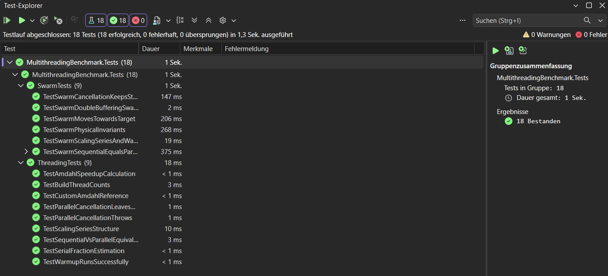
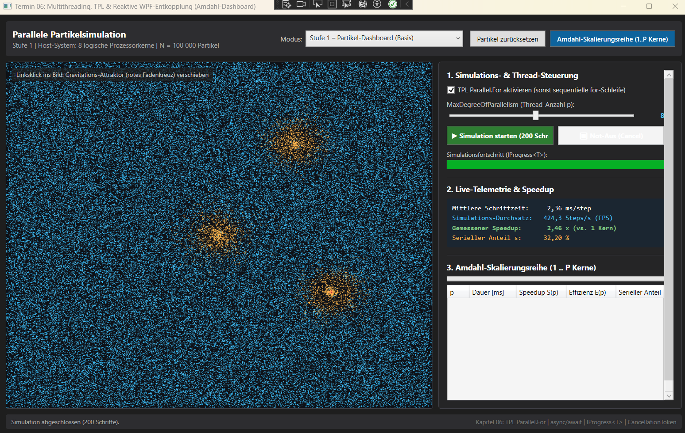
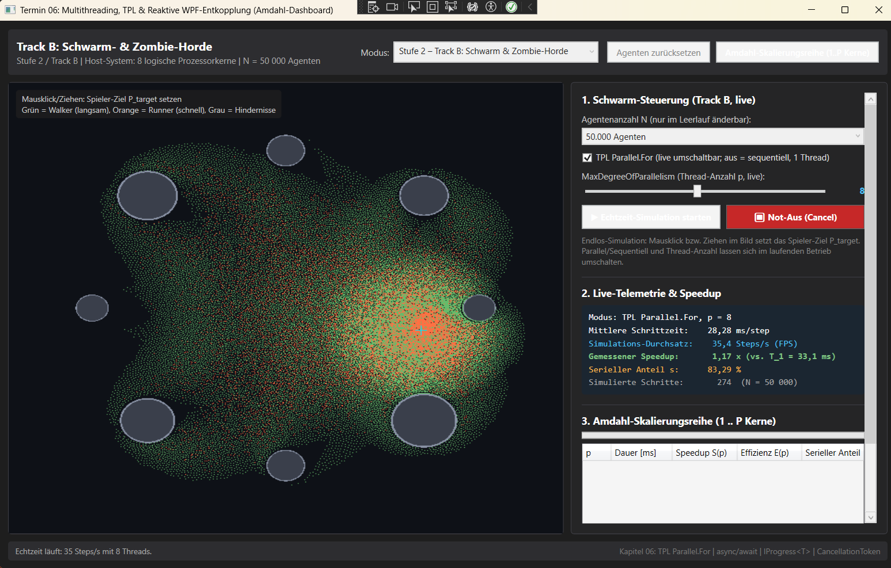
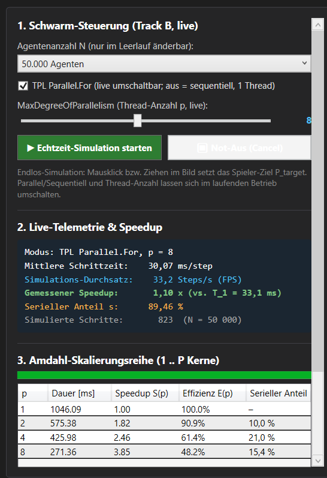

# Aufgabenblatt 06 – Multithreading, TPL & Reaktive WPF-Entkopplung

**Lehrveranstaltung:** Systemsimulation / Digitaler Zwilling · B.Sc. Automatisierungstechnik, 5. Semester   
**Institution:** FH Oberösterreich – Campus Wels   
**Team:** *Brandstätter Nora*, *Reiter Victoria*   
**Gewählter Track (Stufe 2):** **Track B – Simulation Game** (Schwarm- & Zombie-Horden-Simulation, 50.000 – 100.000 Agenten)   
**Technologie:** C# 12 · .NET 8 (`net8.0-windows`) · WPF (`WriteableBitmap`) · TPL · `Stopwatch`

---

## 1. Überblick

Die Anwendung ist ein WPF-Dashboard mit **zwei umschaltbaren Modi**. Die Umschaltung erfolgt über die **ComboBox „Modus“ im Kopfbereich des Hauptfensters**:

| Modus | Inhalt |
| :--- | :--- |
| **Stufe 1 – Partikel-Dashboard (Basis)** | 100.000 Partikel im Zentralfeld-Attraktor. UI-Freeze behoben mit `async/await`, `Task.Run`, `IProgress<T>`, `CancellationTokenSource`; asynchrone Amdahl-Skalierungsreihe; Unit-Tests. |
| **Stufe 2 – Track B: Schwarm & Zombie-Horde** | 50.000 / 75.000 / 100.000 Agenten mit Zielverfolgung, Nachbarschafts-Abstoßung (Spatial Grid), Kreishindernissen, striktem Double-Buffering, Endlos-Echtzeitschleife, Live-Umschaltung sequentiell ↔ `Parallel.For`, Thread-Slider und eigener Skalierungsreihe. |

Die Umschaltung ist nur im Leerlauf möglich (ComboBox ist während eines Laufs deaktiviert) – so besitzt immer genau ein Hintergrund-Task den Simulationszustand.


### Projektstruktur

```
Vorlage/
├── README.md                                 ← dieser Bericht
├── docs/                                     ← Screenshots (siehe Abschnitt 5.4)
├── MultithreadingBenchmark/
│   ├── MainWindow.xaml / .xaml.cs            ← Dashboard, async-Handler, ComboBox-Umschaltung
│   ├── Benchmarks/ParallelRunner.cs          ← Amdahl-Formeln, Messkern, Skalierungsreihen (Stufe 1 + Track B)
│   ├── Simulation/ParticleField.cs           ← Stufe 1: Partikelfeld (Vorlage, unverändert)
│   ├── Simulation/SwarmField.cs              ← Track B: Agenten, Spatial Grid, Double-Buffering
│   └── Infrastructure/
│       ├── FrameBufferPool.cs                ← wiederverwendbare Pixelpuffer (Worker rendert, UI kopiert)
│       └── SwarmModels.cs                    ← RunSettings, TargetPoint, SwarmProgress
└── MultithreadingBenchmark.Tests/
    ├── ThreadingTests.cs                     ← Basis-Tests + TestCustomAmdahlReference + Cancel-Tests
    └── SwarmTests.cs                         ← Track-B-Tests (Bit-Äquivalenz, Invarianten, Double-Buffering)
```


---

## 2. Stufe 1 – Basisaufgabe

### Aufgabe 1.1 – `async/await`, `Task.Run`, `IProgress<SimulationProgress>`

`BtnStart_Click` ist jetzt `async void`. Die 200-Schritte-Schleife läuft in `await Task.Run(() => RunParticleLoop(...), token)`, alle 5 Schritte (und beim letzten) ruft der Worker `progress.Report(new SimulationProgress(...))` auf. Das `Progress<SimulationProgress>`-Objekt wird im UI-Thread erzeugt, fängt dessen `SynchronizationContext` ein und führt `UpdateUiProgress` deshalb immer im UI-Thread aus.

**Warum darf `UpdateUiProgress` bzw. `_bitmap.WritePixels` niemals direkt aus `Task.Run` aufgerufen werden?**
WPF-Objekte (`WriteableBitmap`, `ProgressBar`, alle `DependencyObject`s) haben **Thread-Affinität**: Sie gehören dem Thread, der sie erzeugt hat (UI-Thread / `Dispatcher`). Ein Zugriff aus einem Thread-Pool-Thread wirft sofort eine `InvalidOperationException` („Der aufrufende Thread kann nicht auf dieses Objekt zugreifen …“). Zusätzlich wäre es eine Race Condition, weil der Worker das Partikelfeld währenddessen weiter verändert. `IProgress<T>` löst beides: Es marshalt den Aufruf per `Post` in die Message-Queue des UI-Threads. Daher übernimmt das Datenpaket (`SimulationProgress`) alle Messwerte und das fertige Bild.

### Aufgabe 1.2 – Kooperativer Not-Aus

Zu Beginn von `BtnStart_Click` wird eine neue `CancellationTokenSource` erzeugt und der Not-Aus-Button aktiviert. Das Token geht an `Task.Run` **und** an `StepParallel(Dt, threads, token)` bzw. `StepSequential(Dt, token)`. `Parallel.For` bricht über `ParallelOptions.CancellationToken` ab, die sequentielle Schleife prüft das Token alle 4096 Partikel. `try / catch (OperationCanceledException) / finally` setzt `TxtStatus` auf *„Simulation durch Benutzer (Not-Aus) abgebrochen.“* und stellt die Buttons im `finally` wieder her (inkl. `cts.Dispose()`).

### Aufgabe 1.3 – Asynchrone Amdahl-Skalierungsreihe

`BtnRunScaling_Click` ist `async void` und führt `ParallelRunner.RunScalingSeries(...)` per `await Task.Run(...)` aus. Zusätzlich zur Vorgabe:

* **JIT-Warmup** vor der Messung (`Warmup()`), plus `TieredCompilationQuickJitForLoops=false` in der `.csproj`, damit Schleifen-Kerne sofort voll optimiert kompiliert werden.
* **Best-of-3** je Thread-Stufe (frisches Feld, gleicher Seed 42) gegen Messrauschen.
* Fortschritt via `IProgress<ScalingProgress>` (eigene ProgressBar), Abbruch via Not-Aus.
* Die Tabelle zeigt zusätzlich je Stufe den **rekonstruierten seriellen Anteil s**; darunter stehen Ø *s* (über alle p > 1) und der Grenz-Speedup *S*<sub>max</sub> = 1/*s*.
* Thread-Stufen: p ∈ {1, 2, 4, …, P<sub>max</sub>} plus P<sub>max</sub> selbst, falls keine Zweierpotenz.

### Aufgabe 1.4 – Unit-Tests

| Test | Prüft |
| :--- | :--- |
| `TestSequentialVsParallelEquivalence` *(Vorlage)* | Partikel seq. vs. parallel, Toleranz 1e-12 (`count = 2000`, `seed = 12345`, `dt = 0.001`, 10 Schritte) |
| `TestAmdahlSpeedupCalculation`, `TestSerialFractionEstimation`, `TestWarmupRunsSuccessfully` *(Vorlage)* | Amdahl-Formel, Rekonstruktion von *s*, Warmup |
| **`TestCustomAmdahlReference`** *(neu)* | Golden Values: *S*(4) = 3,076923, *E*(4) = 0,7692 bei *s* = 0,10; *s* = 0,080 aus *S*(8) = 5,128205; *S*<sub>max</sub> = 1/*s*; Rundlauf über p ∈ {2,4,8,16} |
| `TestParallelCancellationThrows`, `…LeavesNoChangeBeforeFirstStep` *(neu)* | Abbruch in beiden Pfaden, kein Zustandsverlust |
| `TestScalingSeriesStructure`, `TestBuildThreadCounts` *(neu)* | Baseline p = 1: *S* = *E* = 1; *s* ∈ [0, 1]; Thread-Stufen {1, 2, 4, …, P<sub>max</sub>} |

Ausführung: Alle Tests in Visual Studio durchführen.   
Ergebnis auf meinem Rechner:   


---

## 3. Stufe 2 – Track B: Schwarm- & Zombie-Horden-Simulation

### B.1 – Agentenmodell & Schwarmdynamik

Agent *i*: Position **x**<sub>i</sub>, Geschwindigkeit **v**<sub>i</sub>, Typ ∈ {Walker (70 %), Runner (30 %)}. Pro Zeitschritt (*Δt* = 0,05) wirkt auf jeden Agenten die Beschleunigung

**a**<sub>i</sub> = **a**<sub>Ziel</sub> + **a**<sub>Wirbel</sub> + Σ<sub>j ∈ N(i)</sub> **a**<sub>Abstoß,ij</sub> + Σ<sub>Hindernisse</sub> **a**<sub>Umgehung</sub>

| Anteil | Modell |
| :--- | :--- |
| Zielverfolgung | Beschleunigung vom Betrag *a*<sub>typ</sub> (Walker 30, Runner 60) zum per Maus gesetzten Punkt **P**<sub>Target</sub>, nahe am Ziel (< 25 Einheiten) linear abgeschwächt |
| Wirbelkraft | Tangentialkomponente innerhalb 200 Einheiten um das Ziel (verhindert Kollabieren der Horde auf einen Punkt) |
| Nachbar-Abstoßung | für Nachbarn mit Abstand *d* < *R* = 6: Betrag *k*·(1 − *d*/*R*) entlang der Verbindungslinie; Nachbarn über **Uniform Spatial Grid** (Zellgröße = *R*, 3×3 Zellen) |
| Hindernisse | 8 Kreishindernisse: weiche radiale + tangentiale Umgehung (Richtung Ziel) und hartes Abprallen (Restitution 0,5) |
| Dämpfung & Begrenzung | *v* ← *v*·(1 − 0,6·*Δt*); ‖**v**‖ ≤ *v*<sub>max</sub> (Walker 22, Runner 45) |
| Ränder | Reflexion an den Kartenrändern [0, 1000]² |

**Spatial Grid:** Pro Schritt wird per Counting Sort (Zellindex → Prefix-Summe → Scatter) eine nach Zellen sortierte Indexliste aufgebaut. Da die Zellen zeilenweise nummeriert sind, bilden die drei Zellen einer Gitterzeile einen **zusammenhängenden** Bereich der Liste – die Nachbarsuche besteht aus nur drei Schleifen. Die Aufwandsklasse sinkt von O(N²) auf O(N).

### B.2 – Striktes Double-Buffering

```csharp
// Lesen NUR aus _current (eigener Zustand + Nachbarn j), Schreiben NUR nach _next[i]
Parallel.For(0, chunks, options, c =>
{
    for (int i = from; i < to; i++)
        UpdateAgent(i, dt, tx, ty, cur, nxt);     // nxt[i] = new Agent(...)
});
(_current, _next) = (_next, _current);             // Swap – nach der Schleife, single-threaded
```

* Jeder Index wird von **genau einem** Thread geschrieben; gelesen wird ausschließlich der unveränderliche `Current`-Puffer ⇒ **keine Race Conditions, kein Tearing**.
* Alle Summationen laufen pro Agent in fester Reihenfolge (Counting Sort ist deterministisch) ⇒ `StepParallel` liefert für **jede** Thread-Zahl **bitgleiche** Ergebnisse wie `StepSequential` (`SwarmTests.TestSwarmSequentialEqualsParallelBitExact`, Toleranz 0).
* Bonus: Bricht der Not-Aus mitten im Schritt ab, ist `Next` nur halb beschrieben, aber `Current` bleibt der konsistente Zustand des letzten vollständigen Schritts (`TestSwarmCancellationKeepsStateConsistent`).
* `Parallel.For` läuft über **Chunks à 256 Agenten** (statt je Agent ein Delegate-Aufruf): geringer Overhead, dynamische Lastverteilung bei ungleichmäßiger Dichte, Abbruchlatenz im Bereich von Millisekunden.

### B.3 – Reaktives Echtzeit-Dashboard

* **Start/Stop:** Endlosschleife in `await Task.Run(() => RunSwarmLoop(...), token)`, Fortschritt/Frames via `IProgress<SwarmProgress>`, Beenden ausschließlich über den Not-Aus (`CancellationTokenSource`). Der Zustand bleibt nach dem Stopp erhalten; „Start“ setzt fort, „Agenten zurücksetzen“ initialisiert neu (Seed 42).
* **Live-Umschaltung:** Die CheckBox *„TPL Parallel.For“* und der Thread-Slider wirken **sofort** im laufenden Betrieb (Sequentiell = 1 Thread ↔ `Parallel.For` mit *p* Threads). Der FPS-/Speedup-Unterschied ist unmittelbar in Bewegungsgeschwindigkeit der Agenten und Telemetrie sichtbar.
* **Telemetrie:** mittlere Schrittzeit, Durchsatz (Steps/s), **Live-Speedup** *S* = *T*<sub>1</sub>/*T*<sub>p</sub> mit automatisch kalibrierter sequentieller Referenz *T*<sub>1</sub> (beim Start auf einem Klon des Schwarms gemessen, im sequentiellen Modus laufend nachgeführt), daraus der serielle Anteil *s* nach Amdahl, simulierte Schrittzahl.
* **Maus:** Klick **oder Ziehen** setzt **P**<sub>Target</sub> (Fadenkreuz) – auch während der Simulation.
* **Agentenanzahl:** ComboBox 50.000 / 75.000 / 100.000 (nur im Leerlauf).

### B.4 – Skalierungsreihe

Button *„Amdahl-Skalierungsreihe (1..P Kerne)“* im Modus Stufe 2: `ParallelRunner.RunSwarmScalingSeries` – dieselbe Methodik wie in Stufe 1 (JIT-Warmup, frischer Schwarm mit Seed 42 je Messung, Best-of-3, 30 Schritte je Messung), asynchron, mit Fortschrittsbalken und Not-Aus. Ergebnisse siehe Abschnitt 5.

---


## 4. Screenshots


### Stufe 1 (Dashboard + Tabelle) 


### Track B (Horde + Telemetrie) 


### Track B (Skalierungsreihe) 



---


## 5. KI-Nutzung

Aufgaben bearbeitet mit Claude Free-Version
