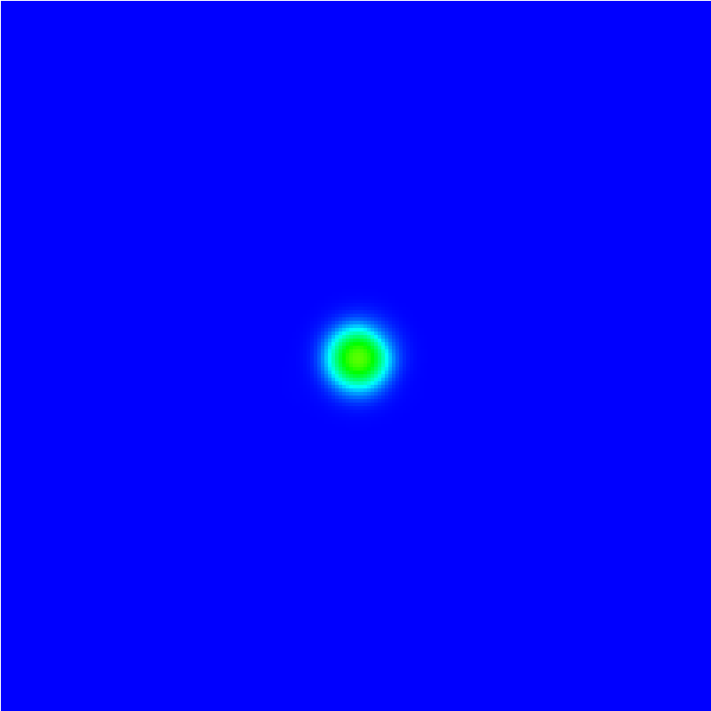
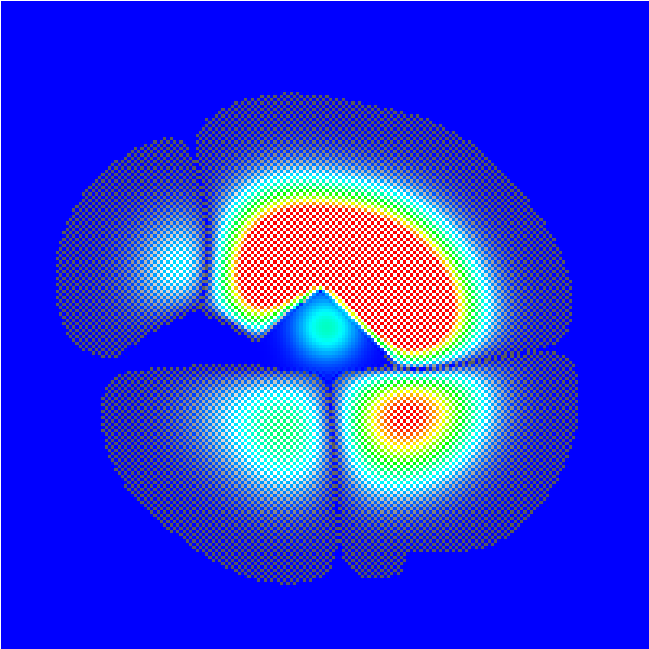
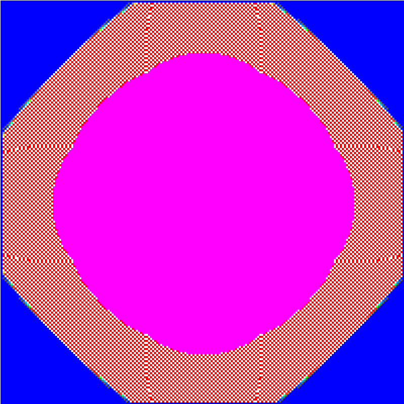

# Sand, Lava & Doom Fire – 2D-FDM-Simulator

**Aufgabenblatt 02 – Stufe B, Track B (Simulation Game)**

Systemsimulation / Digitaler Zwilling · B.Sc. Automatisierungstechnik, 5. Sem. · FH OÖ Campus Wels

**Team:** Brandstätter Nora, Reiter Victoria · 

**Technologie:** C# / .NET 8, WPF, `WriteableBitmap` (`Bgr32`, unsafe `BackBuffer`)

## 1. Überblick

Interaktiver Partikel- und Wärmesimulator auf einem **200 × 200**-Gitter mit zwei Layern:

| Layer | Inhalt | Verfahren |
| :--- | :--- | :--- |
| 1 | Temperaturfeld | FDM, 5-Punkt-Stern, explizites Euler, Double-Buffering |
| 2 | Materialzustand je Pixel | Zellulärer Automat (Falling Sand, Lava, Doom Fire, Holzbrand) |

Alles läuft single-threaded im `DispatcherTimer`, ohne Canvas, `SetPixel` oder `Parallel.For`.

**Start:** In `App.xaml` `StartupUri="TrackBWindow.xaml"` setzen, dann `dotnet run --project PixelHeatFDM`.

## 2. Bedienung

| Eingabe | Aktion |
| :--- | :--- |
| Linke Maustaste | gewähltes Material (Sand / Lava / Holz / Radierer) |
| Rechte Maustaste | Stein-Hindernisse |
| Mittlere Maustaste oder `H` | Hitzebrenner (1200 °C) |
| `1`–`4` | Material wählen |
| `Leertaste` / `R` / `V` / `F12` | Pause / Reset / Ansicht wechseln / Screenshot |

Die GUI bietet außerdem Slider für Δt, a, γ und FDM-Schritte pro Frame, Dirichlet/Neumann-Umschaltung, Stabilitäts-Presets (s = 0,20 … 0,50) und eine Statusanzeige (FPS, T_max/T_min, brennende Pixel, Instabilitätsmeldung).

## 3. Numerik (Layer 1)

$$T^{*}_{i,j} = T^{k}_{i,j} + s_{i,j}\,(T_{i+1,j}+T_{i-1,j}+T_{i,j+1}+T_{i,j-1}-4T_{i,j}),\quad s_{i,j}=\frac{a_{i,j}\Delta t}{\Delta x^2}$$

$$T^{k+1}_{i,j} = T^{*}_{i,j} - \gamma_{i,j}\,\Delta t\,(T^{*}_{i,j}-T_{\text{Luft}})$$

- Strikt `T_old → T_new` mit Pointer-Swap (kein In-Place-Überschreiben).
- Die Abkühlung wird per Operator-Splitting nach der Diffusion angewandt, die Grenze `s ≤ 0,25` bleibt dadurch erhalten.
- Rand: **Dirichlet** (20 °C) oder **Neumann** (`T₀ = T₁`).
- Brennendes Holz wird auf ≥ 900 °C gehalten (Dauer-Wärmequelle).

| Parameter | Wert |
| :--- | :--- |
| Δx | 5 mm |
| a (Luft) | 1,0·10⁻⁴ m²/s |
| Δt | 0,05 s (s = 0,20) |
| γ | 0,1 1/s |
| Physik-Takt | 60 Hz fest, Akkumulator (max. 3 Schritte) |

**Stabilität:** `Δt_krit = Δx² / (4a) = 0,0625 s`. Luft hat den größten Diffusionsfaktor und ist damit der kritische Fall.

## 4. Materialkennwerte

| Material | Diffusionsfaktor | a_eff [m²/s] | Abkühlfaktor | Verhalten |
| :--- | :---: | :---: | :---: | :--- |
| Luft | 1,0 | 1,0·10⁻⁴ | 4,0 | leer |
| Sand | 0,5 | 5,0·10⁻⁵ | 1,0 | fällt, rutscht |
| Lava | 0,003 | 3,0·10⁻⁷ | 0,15 | flüssig, glüht |
| Stein | 0,7 | 7,0·10⁻⁵ | 1,0 | statisch, unbrennbar |
| Holz | 0,1 | 1,0·10⁻⁵ | 1,0 | brennbar |
| Brennendes Holz | 0,1 | 1,0·10⁻⁵ | 1,0 | 5 s, dann Asche |
| Asche | 0,2 | 2,0·10⁻⁵ | 1,0 | rieselt wie Sand |
| Feuer | 0,02 | 2,0·10⁻⁶ | 4,0 | steigt auf |

## 5. Automatenregeln (Layer 2)

Einmal pro Frame, danach 1–4 FDM-Schritte. Zufall: allokationsfreier xorshift32.

**Schwerkraft (Sand, Asche, Lava; von unten nach oben):**
1. Fällt gerade nach unten, wenn `(i, j+1)` Luft ist.
2. Sonst rutscht sie schräg nach `(i±1, j+1)` (bei beiden frei: Zufall).
3. Nur Lava: fließt mit 50 % seitlich, wenn unten alles blockiert ist.
4. Lava kühlt pro angrenzender Luftzelle um 0,5 °C/Frame ab und erstarrt unter **800 °C** zu Stein.
5. Die Temperatur wandert mit dem Partikel. Ein Zeitstempel verhindert Mehrfachbewegung pro Frame.

**Doom Fire (Feuer; von oben nach unten):**

$$T_{i\pm\Delta x_{\text{wind}},\,j-1}^{k+1} = T_{i,j}^{k} - \text{Decay}(\text{Zufall}),\quad \text{Decay}\in[0,20]\,°C$$

Feuer steigt pro Frame eine Zeile auf, Windversatz −1/0/+1. Unter 350 °C oder am oberen Rand verlischt es. Trifft es auf Holz, wird dieses über die Zündtemperatur erhitzt.

**Holz:** Ab 280 °C wird es zu brennendem Holz, das 5 s brennt und mit 25 % pro Frame Feuer erzeugt. Danach wird es zu Asche.

## 6. Rendering

- `Lock()` → `unsafe uint*` auf `BackBuffer` → `AddDirtyRect()` → `Unlock()`.
- **0 Allokationen im Render-Loop:** alle Arrays sind flach und werden einmalig im Konstruktor angelegt.
- Farb-LUTs für Black-Body-Glühen (Schwarz → Dunkelrot → Orange → Gelb → Weiß), Heatmap und Materialfarben mit Pixelrauschen.
- Lava, Feuer und brennendes Holz sind emissiv, andere Materialien glühen ab ca. 250 °C.
- Ziel: ≥ 45 FPS. Die Physik- und Render-Zeit je Frame werden live im Status angezeigt.

## 7. Stabilitätsnachweis

**Vorgehen:** Ansicht *Temperaturfeld* (`V`), Hotspot setzen (`H`), dann über die Presets s erhöhen (Δt bleibt, a wird angepasst).

**Erkennung:** Ein stabiles Verfahren erfüllt das Maximumprinzip. Instabilität wird gemeldet bei `NaN`/`∞`, `T_min < 19 °C` oder `T_max > 5000 °C`. Der erste Schritt wird angezeigt, und es wird automatisch ein Screenshot gespeichert (`Bilder/SandFireFDM_Screenshots`). In der Heatmap erscheinen Unterschwinger grau, `NaN`/`∞` magenta. Es gibt **kein** `Math.Clamp()` auf die Temperatur.

| s | Erwartung |
| :---: | :--- |
| 0,20 | stabil |
| 0,25 | Grenzfall |
| 0,26 | Schachbrettmuster beginnt |
| 0,30 | Streifen/Schachbrett, schnelle Divergenz |
| 0,50 | Explosion, Magenta-Überlauf |

**Erklärung:** Für die Schachbrett-Mode (`kΔx = π`) gilt im 2D-Fall der Verstärkungsfaktor `G = 1 − 8s`. Für `s > 0,25` ist `|G| > 1`, die Mode wächst mit wechselndem Vorzeichen an und läuft gegen ±∞.

**Screenshots:**

s = 0,20
 

s = 0,26
 

s = 0,50

