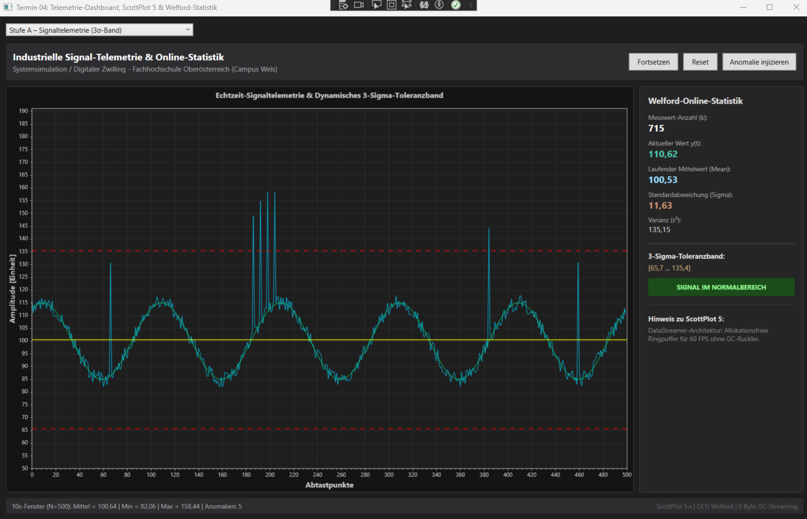
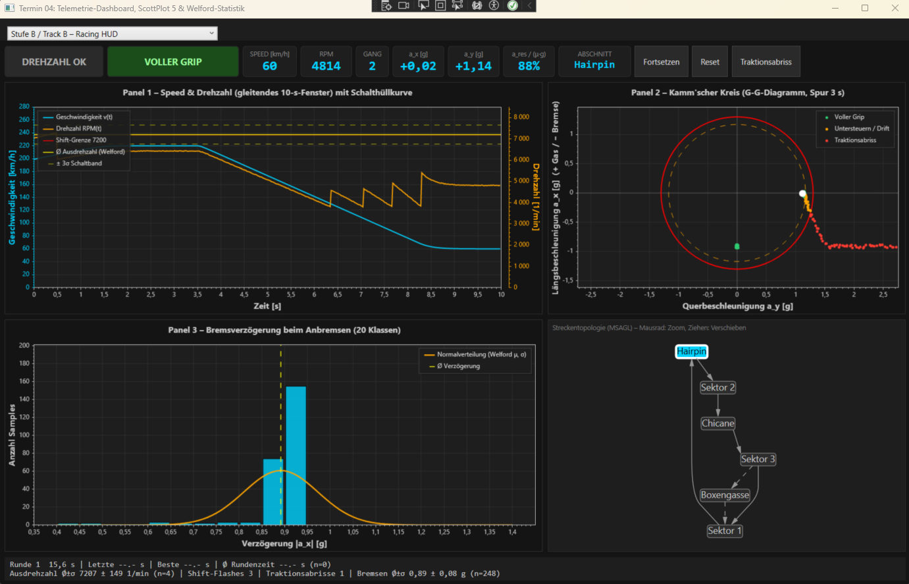

# Termin 04 – Telemetrie, ScottPlot 5 & Welford-Statistik

**Lehrveranstaltung:** Systemsimulation / Digitaler Zwilling   
**Studiengang:** B.Sc. Automatisierungstechnik, 5. Semester – FH Oberösterreich, Campus Wels   
**Bearbeitet von:** Brandstätter Nora, Reiter Victoria   
**Gewählter Track (Stufe B):** **Track B – Retro Arcade Racing HUD & G-Force-Telemetrie**   
**Technologie:** C# 12, .NET 8, WPF, `ScottPlot.WPF` 5.x, `AutomaticGraphLayout.WpfGraphControl` (MSAGL)

---

## 1. Überblick

Das Programm besitzt ein Hauptfenster mit einer ComboBox, über die zwischen zwei Ansichten umgeschaltet wird:

| Ansicht | Inhalt |
| :--- | :--- |
| **Stufe A – Signaltelemetrie** | Zweikanaliger 50-Hz-Leitstand mit Welford-3σ-Band, 10-s-Fensterstatistik und entprelltem Anomalie-Detektor |
| **Stufe B / Track B – Racing HUD** | Vier synchrone Panels: Speed/RPM, Kamm'scher Kreis, Brems-Histogramm und MSAGL-Streckengraph |

Die inaktive Ansicht wird angehalten (Timer gestoppt), sodass immer nur ein 50-Hz-Loop läuft.

### Screenshots


| Stufe A | Track B |
| :---: | :---: |
|  |  |

---

## 2. Projektstruktur

```
ScottPlotTelemetry/
├── App.xaml / App.xaml.cs
├── MainWindow.xaml / .cs        ← ComboBox-Umschalter, Stufe A
├── RacingHudView.xaml / .cs     ← Track B: Dashboard (UserControl)
├── Data/
│   ├── CircularBuffer.cs        ← allokationsfreier Ringpuffer
│   └── TrackSimulator.cs        ← Fahrdynamik-Simulation (Track B)
└── Statistics/
    └── WelfordStatistics.cs     ← Online-Mittelwert/Varianz nach Welford
```

---

## 3. Mathematische Grundlagen

### 3.1 Welford-Algorithmus

Pro Messwert $x_k$ wird genau einmal aktualisiert (O(1) Zeit, O(1) Speicher, keine Historie):

$$\bar{x}_k = \bar{x}_{k-1} + \frac{x_k - \bar{x}_{k-1}}{k}, \qquad
S_k = S_{k-1} + (x_k - \bar{x}_{k-1})(x_k - \bar{x}_k)$$

$$s_k^2 = \frac{S_k}{k-1}, \qquad \sigma_k = \sqrt{s_k^2}, \qquad
y_{\text{upper/lower}} = \bar{x}_k \pm 3\sigma_k$$

Die Klasse `WelfordStatistics` wird mehrfach wiederverwendet:

| Instanz | Gefüttert mit | Verwendung |
| :--- | :--- | :--- |
| `_welford` (Stufe A) | Messsignal y(t) | 3σ-Band, Anomalie-Erkennung |
| `_shiftStats` (Track B) | Drehzahl beim Hochschalten | Schalthüllkurve (Ø Ausdrehzahl ± 3σ) |
| `_brakeStats` (Track B) | Bremsverzögerung \|a_x\| in g | Gauß-Kurve im Histogramm |
| `_lapStats` (Track B) | Rundenzeit in s | Ø ± σ der Rundenzeit |

Es wird nirgends LINQ (`.Average()`, `.Sum()`) für Statistik verwendet.

### 3.2 Fahrdynamik (Track B)

Der Bolide ist eine Punktmasse mit Reibkreis, simuliert in `TrackSimulator`:

| Größe | Formel / Modell |
| :--- | :--- |
| Querbeschleunigung | $a_y = v^2 \cdot \kappa$ (κ = Streckenkrümmung je Abschnitt) |
| Längsbeschleunigung | Gas/Bremse mit Bremspunkt-Planung, PT1-Pedaldynamik |
| Reibkreis | $a_{\text{res}} = \sqrt{a_x^2 + a_y^2} \le \mu \cdot g$, μ = 1,3 |
| Traktionsgrenze | Gasannahme begrenzt auf $\sqrt{(\mu g)^2 - a_y^2}$ |
| Drehzahl | $\text{RPM} = v / v_{\text{Gang,max}} \cdot 7600$, Begrenzer bei 7500 |
| Schaltpunkt | zufällig 6500 … 7400 1/min je Schaltvorgang (streut → Welford-Statistik) |

**Grip-Klassifikation** über die Auslastung $u = a_{\text{res}} / (\mu g)$:

| Auslastung | Farbe | Bedeutung |
| :--- | :--- | :--- |
| u < 0,90 | Grün | Voller Grip |
| 0,90 ≤ u < 1,00 | Orange | Untersteuern / Drift |
| u ≥ 1,00 | Rot | Traktionsabriss |

Pro Runde variieren Kurventempo (Faktor 0,95 … 1,08) und Bremsdruck (0,78 … 1,02), damit alle Zustände und
eine Streuung im Histogramm auftreten. Der Button „Traktionsabriss" injiziert zusätzlich einen kurzen Slide.

---

## 4. Stufe A – Umsetzung

| Aufgabe | Umsetzung |
| :--- | :--- |
| **1. GC-Leak-Fix** | Die vier `SolidColorBrush`-Instanzen sind `private static readonly` und werden per `Freeze()` eingefroren; im Tick werden nur noch Referenzen zugewiesen. |
| **2. Gleitendes Fenster** | Vorallokiertes `_windowCopy`; `_buffer.CopyTo(_windowCopy)` und eine `for`-Schleife liefern Mittelwert, Min und Max der letzten 500 Samples (10 s). Ausgabe in `TxtFooter`. |
| **3. Entprellung & 2. Kanal** | `_anomalyCount` und `_anomalyHoldTicks` (25 Ticks = 0,5 s); `_referenceStreamer` zeigt das ungestörte Sollsignal $100 + 15\sin(2\pi \cdot 0{,}5\,t)$ in Grün. |

---

## 5. Track B – Dashboard-Architektur

### Panel 1 – Speed & RPM mit Schalthüllkurve
- Zwei `DataStreamer` (Kapazität 500, Periode 20 ms → 10-s-Fenster) auf **zwei Y-Achsen** (`Axes.AddRightAxis()`).
- Welford über die Ausdrehzahl liefert Ø und ±3σ als horizontale Linien (erst ab 3 Schaltvorgängen sichtbar).
- **Shift-Flash:** Bei RPM > 7200 blinkt ein rotes „SHIFT!"-Badge, Haltezeit 15 Ticks (0,3 s), Flashes werden als steigende Flanke gezählt.

### Panel 2 – Kamm'scher Kreis
- Punkte (a_y horizontal, a_x vertikal) der letzten 3 s, Haftungsgrenze als roter Kreis (Radius μ), 90 %-Warnkreis gestrichelt.
- Drei `Scatter`-Serien (grün/orange/rot) auf **vorallokierten Arrays**; die Zahl der gezeichneten Punkte steuert `MaxRenderIndex`.
- Aktueller Punkt als größerer Marker in der jeweiligen Zustandsfarbe.
- Der Grip-Badge in der Kopfzeile hat dieselbe Farblogik mit 0,5 s Entprellung und zählt Traktionsabrisse.

### Panel 3 – Brems-Histogramm
- 20 Klassen von 0,40 g bis 1,40 g; ein Sample zählt, sobald a_x < −0,40 g.
- `Bar`-Objekte werden **einmal** erzeugt und nur noch in `Value` aktualisiert.
- Gauß-Kurve aus Welford-μ und -σ, skaliert mit $N \cdot \Delta x / (\sigma\sqrt{2\pi})$; zusätzlich Linie für den Mittelwert.
- Rundenzeiten (letzte, beste, Ø ± σ) stehen in der Fußzeile.

### Panel 4 – MSAGL-Streckentopologie
- Gerichteter Graph: `Sektor 1 → Hairpin → Sektor 2 → Chicane → Sektor 3 → Sektor 1`, dazu die Boxengasse als gestrichelter Umweg (`Sektor 3 → Boxengasse → Sektor 1`, jede dritte Runde befahren).
- Der aktive Knoten wird cyan hervorgehoben. Umgefärbt werden nur die zwei betroffenen Knoten und nur bei Abschnittswechsel (`GraphViewer.Invalidate(...)`), nicht pro Tick.
- Der Graph ist interaktiv (Zoom mit Mausrad, Verschieben mit der Maus).

### Aktualisierungsraten

| Element | Rate |
| :--- | :--- |
| Simulation, Streamer, Panel 1 `Refresh()` | 50 Hz |
| G-G-Diagramm | 25 Hz |
| Histogramm, Textfelder, Fußzeile | 5 Hz |
| MSAGL | nur bei Abschnittswechsel |

---

## 6. Allokationsfreie Architektur

**Maßnahmen im Render-Loop:**

- `CircularBuffer<double>` mit fester Kapazität (`Add` ohne Allokation), `CopyTo` in vorallokierte Arrays.
- Alle Plot-Arrays (G-G-Serien, Gauß-Kurve) und das Histogramm-Array `int[]` sind Felder, die einmalig angelegt werden.
- Alle `SolidColorBrush`-Objekte sind statisch und eingefroren; Farben werden nur bei Zustandswechsel gesetzt.
- `TrackSimulator.Step()` arbeitet ausschließlich mit Feldern und Structs.
- `Random`, Listen, Dictionaries (MSAGL-Knotenzuordnung) werden einmalig erzeugt.

**Bekannte Einschränkungen (ehrlich dokumentiert):**

- `TextBlock.Text = $"..."` erzeugt pro Zuweisung einen kurzlebigen String. In Track B geschieht das nur mit 5 Hz; in Stufe A werden die Dashboard-Texte (Vorlage) weiterhin mit 50 Hz formatiert.
- ScottPlot erzeugt beim Rendern intern kleine, kurzlebige Objekte (z. B. Views auf Datenquellen). Diese lassen sich aus der Anwendung heraus nicht vermeiden.

„0 B Allokation" gilt daher für **Puffer-, Simulations- und Statistiklogik**. Der tatsächliche Wert ist im Profil (Abschnitt 7) zu belegen.

---

## 7. Verwendete Hilfsmittel

KI-Assistenten (Claude & Gemini) für Codegerüst und Dokumentation; 
